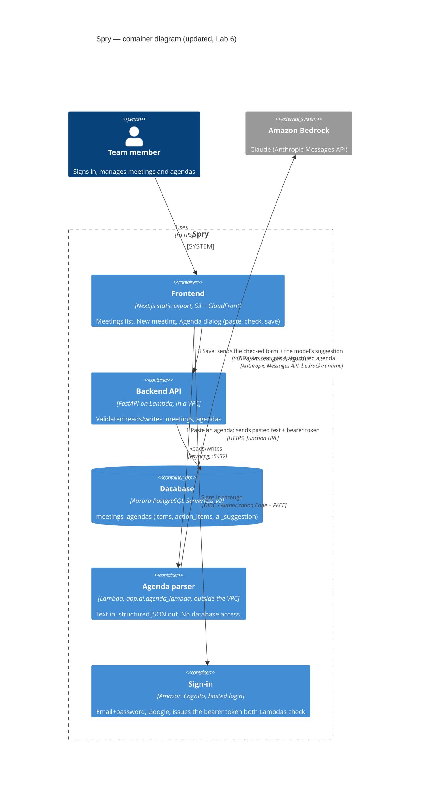

# Spry — container diagram (C4, level 2)

Updated for Lab 6, Part 4, Step 6: adds the agenda-parser Lambda and Amazon Bedrock, and the two
new arrows - **parse** (browser → parser → Bedrock, outside the VPC) and **save** (browser → API →
Aurora, same validated path every other write already uses).

Lab 1's original diagram was built outside this repository; this Mermaid version is the
versioned, up-to-date replacement checked in with the code it describes; re-render it with any
Mermaid-compatible viewer (GitHub renders it inline, mermaid.live, the `artifact-diagramming`
skill, etc.).

Notes that matter for the diagram, not just the code:

- The **parser never touches the database** and sits **outside the VPC** - no NAT, no VPC
  interface endpoint, $0 when idle (same split as Lab 5's report mailer vs. report builder).
- **Two separate arrows reach the backend**: the agenda dialog's *Save* button (step 3) goes
  through the same validated `PUT /api/meetings/{id}/agenda` every hand-typed agenda uses. The
  parser (steps 1-2) never calls the backend and never writes - "the model suggests, the person
  decides" (Part 0).
- **Cognito** is drawn once because both Lambdas check the same bearer token: the backend's
  routes do not yet require it (pre-Lab 6 scope), but the parser does, since every call there
  costs money (Part 4, Step 3).
